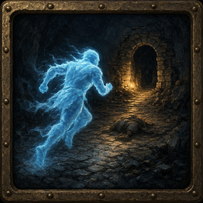

<p align="center"></p>

# Runback

Runback is an addon for World of Warcraft: Forever (Interface 16001) with a small Node bridge that runs on your PC. Today it lets you chat with local coding agents (Claude Code, Codex, Grok Build and others) from inside the game. The agent can see your character and draw routes on your map. I am turning it into a coaching tool you check between pulls. That part is still in progress.

Runback is a fork of [chelinho139/wow-ai](https://github.com/chelinho139/wow-ai). The chat, the bridge and the map work are theirs. Thank you.

## What works today

- Several chats in one window, each its own agent session, running in parallel.
- Live progress while the agent works, and replies echoed into the game chat.
- Optional game context: character, level, zone, talents, professions and quest log. You can shift-click items, spells and quests into a message.
- Quick prompts: `/ai review`, `death`, `build`, `gear`, `quest`, `level`, `drill`, `practice`, `recap`, `bags`, `look`.
- Map layers drawn by the agent: numbered routes, quest stops and a navigator arrow.
- Herb and ore spawns you can show on the world map (`/runback map herb`, `/runback map ore`), filtered by your gathering skill. This needs the optional `WoWAI_Nodes` data addon.
- Runs on Windows, and on Linux with the game under Wine (X11).

The addon uses documented addon APIs only. It does not inject code, read game memory or send input. The bridge reads a small strip of pixels from your screen and writes ordinary files.

## Planned (in progress)

None of this is built yet.

- Between-pull checklists per spec: cooldown use and buff uptime, read from combat events.
- A companion outside the game that reads your Warcraft Logs reports and sims.

## Requirements

- World of Warcraft: Forever, TOC 16001, windowed or borderless (exclusive fullscreen blocks screen capture).
- Windows (NTFS), or Linux with the game under Wine on X11 plus python3.
- Node.js 22.2 or newer.
- At least one agent CLI installed and logged in. Install notes are in [docs/AGENTS.md](docs/AGENTS.md).

## Install

The addon in this repo is `addon/Runback`. `setup.js` copies it to `Interface\AddOns\Runback`.

```powershell
git clone https://github.com/Nercari/runback
cd runback
node setup.js --project "C:\path\to\your\project"
```

`setup.js` finds the client, writes `bridge/config.json` when that file is missing, and builds the reply-slot addons. Pass `--wow "<client folder>"` when it cannot find the client (the folder needs `Interface` and a `Wow*.exe`). On Linux it searches Wine prefixes (`$WINEPREFIX`, `~/.wine`, `~/Games/battlenet`) for a World of Warcraft client.

Then:

1. Fully quit and restart WoW. The client only discovers new addon files at launch. On the character-select AddOns screen, enable **Runback**. Leave the Runback slot entries enabled.
2. If you used WoW AI before, `node setup.js` moves the old `WoWAI` folder out of `Interface\AddOns` into `Runback-backup-<date>` next to the game client, so the two addons do not run side by side.
3. In this repo, start the bridge with `npm start`. On Windows, `bridge\start-window.cmd` opens its own window. Leave it running while you play. In game, `/runback` opens the window.
4. On Linux, use the same steps. Once, while the colored strip is in the top-left of the game window, run `npm run probe`. It saves what the capture sees to `bridge/probe.png` and says whether it decoded the strip.
5. `npm run doctor` any time. It only reads. It prints PASS or FAIL for Node.js 22.2 or newer, for a logged-in `claude`, `codex`, or `grok`, and for X11 (`DISPLAY` set). Windows passes the X11 check. A FAIL line includes a one-line fix, and the process exits with an error if any check fails.

Step-by-step with troubleshooting: [docs/INSTALL-WINDOWS.md](docs/INSTALL-WINDOWS.md) and [docs/INSTALL-LINUX.md](docs/INSTALL-LINUX.md).

## Usage

| Command | What it does |
|---|---|
| `/runback <text>` | Main command. With no text, toggles the window. With text, sends it to the current chat, unless the first word is a subcommand such as `help` or `map`. |
| `/rb <text>` | Same command, only when no other addon already owns `/rb` at load. |
| `/wowai <text>` | Legacy alias of `/runback`. |
| `/ai <text>` | Short alias of `/runback`, including the quick prompts (`/ai review`, and the rest of the list above). |
| `/aimap` | Map layers, the navigator and herb/ore nodes. Same as `/runback map`. |
| `/wow-ai`, `/wow-claude`, `/ask` | Aliases of `/runback`. |

## Migrating from WoW AI

Close the game and run `node setup.js`. It copies each account's `WTF/Account/<ACCOUNT>/SavedVariables/WoWAI.lua` to `Runback.lua` in the same folder when `Runback.lua` is not there yet, and leaves `WoWAI.lua` in place. Start the game.

Leave the names inside that file as they are. On load, when a new saved table is missing, the addon copies it from the legacy table (`WoWAIDB` into `RunbackDB`, and the same for the map, guide, forever and bulk tables).

An older wow-claude install is different. With the game closed, `node setup.js` copies `WoWClaude.lua` to `Runback.lua` when `Runback.lua` is not there yet, and moves the old `WoWClaude` addon and `WoWClaude_S###` slot folders to `Runback-backup-<date>` next to the game client. Details are in [docs/INSTALL-WINDOWS.md](docs/INSTALL-WINDOWS.md).

## License

MIT. See [LICENSE](LICENSE). © chelinho139, © 2026 Nercari
